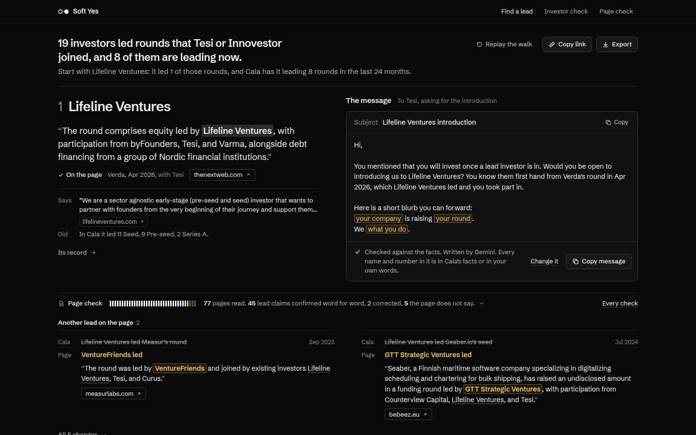

# Soft Yes

Turn "we're in if you find a lead" into a lead.

**Live:** https://soft-yes.fly.dev · **Check us:** https://soft-yes.fly.dev/audit · Built at Junction 2026 on [Cala](https://cala.ai), for the challenge "Make Unicorns Real".



## What it does

Every founder hears it: "We like it. We're in once you have a lead." It sounds like a yes. It is homework.

Type the investors who told you that. Soft Yes then

1. walks Cala's graph: the rounds those investors joined, and who led each one,
2. opens the page Cala cites for every "led" and looks for the sentence that says so,
3. ranks the leads that hold by how often and how recently they lead,
4. opens on one answer: the lead to ask first, the page's sentence that says it led, and the intro request to the investor who said yes, written from those facts only.

A lead that survives has already done a deal with your investor, and you can quote the sentence that proves it.

## Why the page check matters

Write "you led X" to an investor who did not lead X and the intro is gone. A graph is only safe to act on when each fact comes with the sentence behind it.

So a "led" in Cala counts only when the cited page says it:

- **Confirmed:** the sentence is shown word for word, the name marked.
- **Corrected:** the page names another lead. Cala's claim is struck through and the page's sentence shown.
- **The page does not say:** shown as that, never counted as confirmed.

Example from the live site (Tesi + Innovestor, Series A): Cala credits Lifeline Ventures with three rounds next to Tesi. The pages confirm one (Verda: "The round comprises equity led by Lifeline Ventures, with participation from byFounders, Tesi, and Varma"). For Measur and Seaber the pages name VentureFriends and GTT Strategic Ventures. Those two never reach an email.

All of it is public at [/audit](https://soft-yes.fly.dev/audit): the totals over every walk, ten claims at random, the corrections as a CSV, and "Check a company" for any company by name.

## Does it find the real lead?

We tested the walk on rounds that already happened. Each of 201 past rounds was hidden together with everything dated after it, and the walk was run from the investors who followed.

- From two followers the real lead was on the list in 13 of 57 rounds (23%). A lead picked at random from the same year is there 10% of the time.
- From one follower it was 8 of 144 (6%), against 4% at random: too close to chance to count.
- Over all 201 rounds the real lead was in the top five in 10. Counting how many rounds a lead has led at the round's stage, as the ranking now does, leaves the top five where it was (11 before, 11 after, by the product's own weight) and moves two more leads into the top ten (13 to 15).

So give it two, and read the list as doors your investors can open, not as a forecast. The numbers, three hits and a miss are at the bottom of [/audit](https://soft-yes.fly.dev/audit#backtest). `uv run python -m softyes.backtest --dry` recomputes them from the cache with no Cala call.

## How Cala is used

Cala is the whole product. The rounds, who joined, who led and the page behind each fact all come from it.

| Call | What for |
| --- | --- |
| `GET /v1/entities?name=` | Find the investor or company that was typed |
| `POST /v1/entities/{id}` (investor) | Its funding rounds with the lead flag and sources on each, in one call |
| `POST /v1/entities/{id}` (round) | Everyone in the round, who is marked lead, the sources |
| `POST /v1/entities/{id}` (company) | A company's rounds, for "Check a company" and the `who_led` tool |
| `POST /v1/entities/{id}` (profile) | Website, people, where it is based |
| `POST /v1/knowledge/search` | When the graph holds no round for a company. Only sentences from the pages it read are kept |

Every call is stored in SQLite and never made twice. Each run shows its own count: Cala calls, facts, sources, and 0 facts from a language model.

It also gives back. The audit list is every place where Cala's graph and Cala's own source disagree, with the sentence. Each row is one fix to the graph.

## Oxylabs

Cala knows what a fund did. It does not know what the fund says about itself. Oxylabs reads that.

- `POST /v1/scrape` reads the fund's own site (the home page and up to two "about" pages). The first five leads of every run get one line: the fund's own sentence next to what Cala shows it did. It also re-reads a cited page that does not open directly.
- `POST /v1/search` finds the fund's own site when Cala has none, or when the address Cala holds does not open.

## Gemini

Gemini has two jobs, and code checks both.

- `gemini-4-hydrogen` writes the intro request from a fact sheet while you wait. Code drops a draft that contains a name or a number that is not in those facts, and the page says so. After two failed tries a plain template is used and no model is involved.
- `gemini-4-carbon` points at sentences on a fund's site, where nobody waits. Code keeps a sentence only when it is on the page word for word.

No model picks, ranks or checks a lead.

## Slush and MCP

- The Slush attendee directory (through Slush's MCP, read only) shows which leads are in Helsinki next week.
- Soft Yes is an MCP server itself at `https://soft-yes.fly.dev/mcp` with four tools: `find_lead`, `check_investor`, `draft_intro`, `who_led`. Your own assistant can run the walk or ask who led any company's round, and gets the page's sentence back.

## What's real

- Everything on screen is live data read from Cala during the hackathon. There is no mock data and no hand-written answer. The examples on the home page are real walks, served from the cache.
- The audit numbers are counted from the stored walks when you open the page. They grow as people use it.
- Some cited pages do not open (paywalls, dead links). Some do not say who led. Both are shown as what they are.
- Cala does not hold every round of every fund. Each investor shows how many rounds Cala lists for it, and how many of its "led" flags a page has confirmed so far.
- With too few rounds to rank, the result says so and shows a list, not a first pick.
- "Says vs did" reads only the public pages of a fund's own site.
- Nothing is sent for you. The intro request and the Slush note are drafts.
- On the public site one visitor can cause 150 fresh Cala calls a day. After that it serves what has already been read.

## Run it

Needs Python 3.12+ with [uv](https://docs.astral.sh/uv/), Node 20+ and a Cala API key.

```bash
cp .env.example .env        # add your keys; only the Cala key is required
cd web && npm install && npm run build && cd ..
./run.sh                    # http://127.0.0.1:8655
```

Without the Gemini key the drafts come from the template. Without the Oxylabs key "says vs did" is off. Without the Slush token the Slush lines are off.

## Where things are

- `softyes/walk.py` the walk and the ranking · `softyes/pagecheck.py` the page check · `softyes/backtest.py` the test on past rounds · `softyes/graph.py` and `softyes/cala.py` the Cala client · `softyes/extras.py` drafts, says vs did, Slush · `softyes/mcp.py` the MCP server · `softyes/api.py` the HTTP API
- `web/` the React app · `deploy/` the Fly setup · `film/` the demo film's source
- [BUILD_LOG.md](BUILD_LOG.md) what was built when

## Licence

MIT, see [LICENSE](LICENSE).
