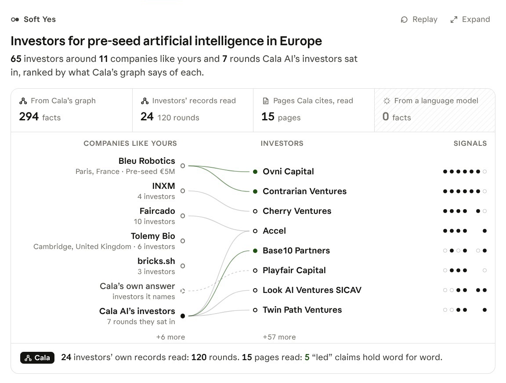
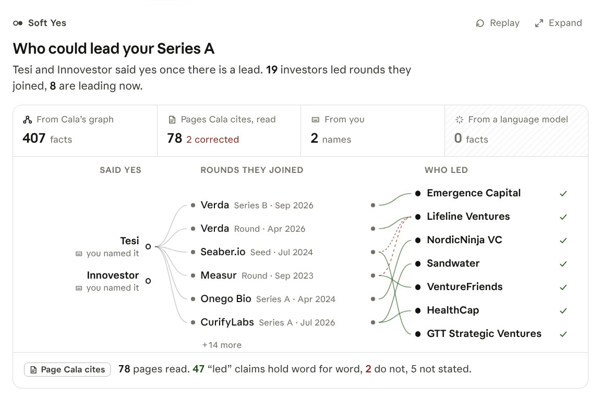

# Soft Yes

Find your investors in Cala's graph, in Claude. Then turn "we're in once you have a lead" into a lead.

**In Claude:** add `https://soft-yes.fly.dev/mcp` as a connector · **Live:** https://soft-yes.fly.dev · **Check us:** https://soft-yes.fly.dev/audit · Built at Junction 2026 on [Cala](https://cala.ai), for the challenge "Make Unicorns Real".



## What it does

Soft Yes is a connector for Claude. You ask in the chat and the answer is a card drawn there, from Cala's graph.

**Who should I talk to?** Say what you build, your stage and where you are. Soft Yes then

1. asks Cala's graph for companies like yours,
2. reads their rounds and who invested, and the rounds joined by investors you already know,
3. reads Cala's own record of each investor it lists,
4. ranks them by what that record says: backs your field, leads rounds, at your stage, active now, your round size, near you, and a way in through someone you know.

**Who could lead?** Every founder hears it: "We like it. We're in once you have a lead." Name the investors who told you that. Soft Yes then

1. walks Cala's graph: the rounds those investors joined, and who led each one,
2. opens the page Cala cites for every "led" and looks for the sentence that says so,
3. ranks the leads that hold by how often and how recently they lead,
4. writes the intro request to the investor who said yes, from those facts only, with one click in the card.

A lead that survives has already done a deal with your investor, and you can quote the sentence that proves it.

Try it in Claude:

> We're building in artificial intelligence in Europe and raising a pre-seed round. Use Soft Yes to find the investors who fit, and who Cala AI's investors could introduce us to.

> Tesi and Innovestor said they're in once we have a lead. Use Soft Yes to find who could lead our Series A.

No Claude at hand: the same cards are at https://soft-yes.fly.dev/chat, and the lead search has its own site at https://soft-yes.fly.dev.



## Why the page check matters

Write "you led X" to an investor who did not lead X and the intro is gone. A graph is only safe to act on when each fact comes with the sentence behind it.

So a "led" in Cala counts only when the cited page says it:

- **Confirmed:** the sentence is shown word for word, the name marked.
- **Corrected:** the page names another lead. Cala's claim is struck through and the page's sentence shown.
- **The page does not say:** shown as that, never counted as confirmed.

Example (Tesi + Innovestor, Series A): Emergence Capital comes first. It led Verda's $189M Series B with Tesi in it, and verda.com says so: "The financing includes an oversubscribed Series B led by Emergence Capital". Cala also credits Lifeline Ventures with three rounds next to Tesi. The pages confirm one (Verda, April 2026). For Measur and Seaber the pages name VentureFriends and GTT Strategic Ventures. Those two never reach an email.

All of it is public at [/audit](https://soft-yes.fly.dev/audit): the totals over every walk, ten claims at random, the corrections as a CSV, and "Check a company" for any company by name.

## Does it find the real lead?

We tested the walk on rounds that already happened. Each of 201 past rounds was hidden together with everything dated after it, and the walk was run from the investors who joined.

- From two investors who joined, the real lead was on the list in 13 of 57 rounds (23%). A lead picked at random from the same year is there 10% of the time.
- From one it was 8 of 144 (6%), against 4% at random: too close to chance to count.
- Over all 201 rounds the real lead was in the top five in 10.

So name two investors, and read the list as doors your investors can open, not as a forecast. The numbers, three hits and a miss are at the bottom of [/audit](https://soft-yes.fly.dev/audit#backtest). `uv run python -m softyes.backtest --dry` recomputes them from the cache with no Cala call.

## How Cala is used

Cala is the whole product. The rounds, who joined, who led and the page behind each fact all come from it.

| Call | What for |
| --- | --- |
| `POST /v1/knowledge/query` | The companies in a field, at a stage, in a place. The card shows the exact question |
| `GET /v1/entities?name=` | Find the investor or company that was named |
| `POST /v1/entities/{id}` (investor) | Its funding rounds with the lead flag and sources on each, in one call |
| `POST /v1/entities/{id}` (round) | Everyone in the round, who is marked lead, the sources |
| `POST /v1/entities/{id}` (company) | A company's rounds, for the investor search, "Check a company" and the `check_claim` tool |
| `POST /v1/entities/{id}` (profile) | Website, people, where it is based |
| `POST /v1/knowledge/search` | The investor question in plain words, shown apart as Cala's own answer. Also when the graph holds no round for a company: only sentences from the pages it read are kept |

Every call is stored in SQLite and never made twice. Each card shows its own count: facts from Cala, records and pages read, and 0 facts from a language model.

It also gives back. The audit list is every place where Cala's graph and Cala's own source disagree, with the sentence. Each row is one fix to the graph.

## Oxylabs

Cala knows what a fund did. It does not know what the fund says about itself. Oxylabs reads that.

- `POST /v1/scrape` reads the fund's own site (the home page and up to two "about" pages). The first five leads of every run get one line, "says vs did": the fund's own sentence next to what Cala shows it did. It also re-reads a cited page that does not open directly.
- `POST /v1/search` finds the fund's own site when Cala has none, or when the address Cala holds does not open.

## Gemini

Gemini has two jobs, and code checks both.

- `gemini-4-hydrogen` writes the intro request from a fact sheet while you wait. Code drops a draft that contains a name or a number that is not in those facts, and the page says so. After two failed tries a plain template is used and no model is involved.
- `gemini-4-carbon` points at sentences on a fund's site, where nobody waits. Code keeps a sentence only when it is on the page word for word.

No model picks, ranks or checks a lead.

## Claude and Slush

- Soft Yes is an MCP server at `https://soft-yes.fly.dev/mcp`. Add it to Claude as a custom connector, no sign-in. The tools: `find_investors`, `find_lead`, `explore_network`, `draft_intro`, `check_claim`, `check_investor`, `round_tracker`. Each answer is drawn as a card in the chat. How to demo it: [CLAUDE_DEMO.md](CLAUDE_DEMO.md).
- On the site, the Slush attendee directory (through Slush's MCP, read only) shows which leads are at Slush.

## What's real

- Everything on screen was read from Cala. There is no mock data and no hand-written answer. The examples on the home page are real walks, served from the cache.
- The audit numbers are counted from the stored walks when you open the page. They grow as people use it.
- Some cited pages do not open (paywalls, dead links). Some do not say who led. Both are shown as what they are.
- Cala does not hold every round of every fund. Each investor shows how many rounds Cala lists for it, and how many of its "led" flags a page has confirmed so far.
- With too few rounds to rank, the result says so and shows a list, not a first pick.
- "Says vs did" reads only the public pages of a fund's own site.
- Nothing is sent for you. The intro request is a draft.
- On the public site one visitor can cause 150 fresh Cala calls a day. After that it serves what has already been read.

## Run it

Needs Python 3.12+ with [uv](https://docs.astral.sh/uv/), Node 20+ and a Cala API key.

```bash
cp .env.example .env        # add your keys; only the Cala key is required
cd web && npm install && npm run build && cd ..
./run.sh                    # http://127.0.0.1:8655
```

Without the Gemini key the drafts come from the template. Without the Oxylabs key "says vs did" is off. Without the Slush token the Slush lines are off.

## Where things are

- `softyes/scout.py` the investor search · `softyes/walk.py` the walk and the ranking · `softyes/pagecheck.py` the page check · `softyes/backtest.py` the test on past rounds · `softyes/graph.py` and `softyes/cala.py` the Cala client · `softyes/extras.py` drafts, says vs did, Slush · `softyes/mcp.py` the MCP server · `softyes/api.py` the HTTP API
- `chat/` the cards drawn in Claude · `web/` the React site · `deploy/` the Fly setup · `film/` the demo film's source
- [BUILD_LOG.md](BUILD_LOG.md) what was built when

## Licence

MIT, see [LICENSE](LICENSE).
